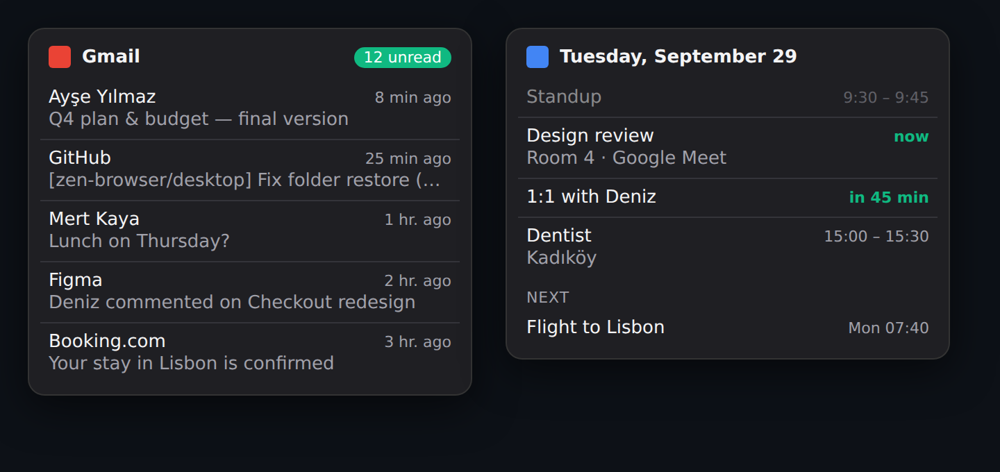
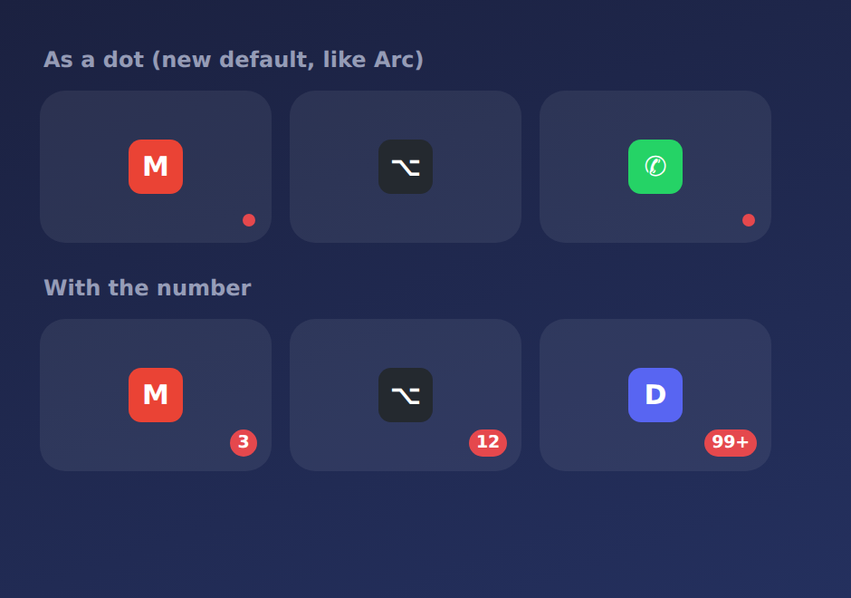

<div align="center">


# Zen Peek

**Hover an Essential, see what's inside.**

Arc-style previews and unread badges for [Zen Browser](https://zen-browser.app): your latest mail, today's calendar, GitHub pull requests, Reddit, deploys on Vercel and Netlify, Sentry issues, the weather, or a snapshot of the page. You don't have to switch tabs, and nothing goes through a server: everything runs in your browser with your own logins and tokens.



<br><sub>The Gmail and Calendar cards (a mock-up with sample data, drawn with the mod's own styles).</sub>

</div>

---

## What you get

Hover an Essential for a moment (0.3 s) and a card pops out next to it:

| Essential | Preview | Setup |
| --- | --- | --- |
| **Gmail** | Unread count and your latest unread mails (sender, subject, time), in one list that scrolls (5 to 20 mails). **+** writes a new mail. Click one to open it. | None: uses the Google account you're signed in to in Zen. Works per account (`/mail/u/0`, `/u/1`, …). |
| **Google Calendar** | Today's events: past ones dimmed, "now" and "in 25 min" highlighted, a **Join** button for Meet/Zoom/Teams meetings, a timeline of the day with the current time, a colour per calendar, and your next event if today is done. **+** adds an event. Handles recurring events (including "2nd Tuesday", "last Friday"), time zones and moved meetings. | Paste your calendar's private iCal address once (see below). |
| **GitHub** | Pull requests waiting for your review, your open PRs with their review status and CI (✓ ✗ ●), and unread notifications (✓ marks one as read). Click to open. | A personal access token with the `notifications` scope (add `repo` to include private repositories). |
| **Reddit** | Unread replies and messages (with a badge), and posts from your home feed. On a subreddit Essential (`reddit.com/r/…`), its hot posts. **+** writes a post. | None: uses the Reddit account you're signed in to in Zen. |
| **Vercel** | Latest deployments: project, branch or production, commit message, status (✓ Ready, ✗ Failed, ● Building) and time. The badge counts projects whose latest deploy failed. On a team's address (`vercel.com/your-team`), that team. **+** starts a new project. | A Vercel token (see below). |
| **Netlify** | The latest deploy of your most recently updated sites, with the same statuses and badge. **+** starts a new site. | A Netlify personal access token (see below). |
| **Sentry** | Unresolved issues, latest first: title, project, short ID, how often it happened. New issues (first seen in the last 24 hours) are highlighted and counted in the badge. On `your-org.sentry.io`, that organization; otherwise your first one. | A Sentry personal token (see below). |
| **Hacker News** | Top stories. | None. |
| **Weather** | Now, today's high and low, and the next hours (Open-Meteo). On weather sites (AccuWeather, weather.com, yr.no, Windy, MGM, Met Office…), or any Essential you choose. | Set a city once (in the card, or in the settings). Only the city name is sent. |
| **Any other site** | A snapshot of the page when the tab is open; otherwise its title and address. | None. |

Moving from one Essential to the next switches the card instantly; moving toward the card keeps it open, even across other Essentials. Press **Esc** or move away to close it.

**Unread badges.** Essentials get a small Arc-style dot in the corner when something is unread (or the number, if you prefer), without hovering: Gmail unread mail, GitHub review requests and notifications, Reddit unread messages, failing Vercel and Netlify deploys, new Sentry issues, and any site that puts a count in its title, like `(3) WhatsApp`, Slack, Discord, Telegram or Messenger. Data refreshes in the background, only in the window you're using.



**On any card:** **Show more** reveals more items. Cards have a fixed width (a setting) and grow with their content up to a limit, then scroll; nearly empty cards stay small.

**Show as.** Right-click an Essential → **Zen Peek: show as** to pick its card: Automatic, Page preview, or any card (say, Weather on a site Zen Peek doesn't know).

**Setup in the card.** Calendar addresses, tokens (GitHub, Vercel, Netlify, Sentry) and the weather city are entered in a small form inside the preview (Enter saves, Esc cancels). Secrets go to Zen's password manager.

**Keyboard.** **Alt+Shift+P** previews the focused Essential (or the first one). **↑/↓** move between items, **Enter** opens, **←/→** switch Essential, **Esc** closes.

## Install

You need [Zen Browser](https://zen-browser.app) and the [Sine](https://github.com/CosmoCreeper/Sine) mod manager.

1. Install Sine by following the instructions in [its repository](https://github.com/CosmoCreeper/Sine).
2. In Sine's settings, allow **unofficial/unsafe JS mods**. The code is short and readable in [`mod/`](mod).
3. In Sine, install from this repository's URL:
   ```
   https://github.com/hajorda/ZenPeek
   ```
4. Restart Zen.

## Set up Google Calendar

1. Open [Google Calendar settings](https://calendar.google.com/calendar/r/settings) and pick your calendar on the left.
2. Under **Integrate calendar**, copy **Secret address in iCal format**.
3. In Zen, hover your Calendar Essential and click **Set calendar address…**. You can also right-click the Calendar Essential → **Zen Peek: set calendar address…**.
4. Paste it. For several calendars, paste several addresses separated by spaces.

> [!WARNING]
> Anyone with the secret address can read that calendar. Zen Peek keeps it in Zen's password manager, not in plain settings. If it ever leaks, reset it in the same Google Calendar setting.

## Set up GitHub

1. Create a [classic personal access token](https://github.com/settings/tokens/new?scopes=notifications&description=Zen%20Peek) with only the **notifications** scope.
2. Right-click your GitHub Essential → **Zen Peek: set GitHub token…** and paste it.

## Set up Vercel, Netlify or Sentry

Each needs a personal token, created once on the site and entered in the card (hover the Essential, then **Set … token…**, or right-click it → **Zen Peek: set … token…**). Tokens are kept in Zen's password manager.

| Site | Where to create the token | What it needs |
| --- | --- | --- |
| **Vercel** | [Account Settings → Tokens](https://vercel.com/account/tokens) | Read access to your account (and your teams, for team cards) |
| **Netlify** | [User settings → Applications → Personal access tokens](https://app.netlify.com/user/applications#personal-access-tokens) | A personal access token |
| **Sentry** | [User settings → Personal Tokens](https://sentry.io/settings/account/api/auth-tokens/) | `org:read` and `event:read` |

Reddit needs no token: being signed in to Reddit in Zen is enough. If you aren't, the card offers **Sign in**.

## Settings

Open Sine → Zen Peek. Changes apply right away; no restart needed.

| Section | Setting | Default |
| --- | --- | --- |
| General | Preview style: Floating card · Classic | Floating card |
| | Show the preview after hovering for (0.2 – 1.2 s) | 0.3 s |
| | Closing: Smart (stays open while you move toward it) · After a pause (0.4 s) | Smart |
| | Card width · items per card · animation | Normal · 5 · Normal |
| | Clicking an item opens it in that Essential's tab · a new tab | Same tab |
| | Keyboard shortcut: Alt+Shift+P · Ctrl+Alt+P · off | Alt+Shift+P |
| | Colours: Match Zen · Zen Peek | Match Zen |
| | "+" button on Gmail and Calendar | On |
| | "Show more" button when a card has more items | On |
| Badges | Show unread badges: as a dot (like Arc) · with the number · off | Dot |
| | Read unread counts from page titles (chat apps) | On |
| Data | Refresh at most every 30 s · 1.5 · 5 · 15 min | 1.5 min |
| | Keep Essentials' data up to date in the background | On |
| | Remember previews between restarts | On |
| | Give up on a service that doesn't answer after 5 · 10 · 20 · 30 s | 10 s |
| Cards | Gmail · Google Calendar · GitHub · Hacker News · Weather · Reddit · Vercel · Netlify · Sentry (off = page snapshot) | On |
| Gmail | Show the first lines of each mail | Off |
| | Mails to show (the card scrolls): 5 · 10 · 15 · 20 | 10 |
| Calendar | Past events (dimmed) · next event when today is done | On · On |
| | "Join" button: from 10 min before · always · off | From 10 min before |
| | Today as a timeline · a colour per calendar | On · On |
| Weather | Place (a city) · units °C/km/h or °F/mph | — · °C |
| GitHub | Review requests · my PRs · CI status · ✓ mark as read · notifications | All on |
| Reddit | Also show posts from your home feed | On |
| Other sites | Page snapshot when the tab is open · also preview pinned tabs | On · Off |
| Troubleshooting | Log what Zen Peek does to the Browser Console | Off |

Ctrl/Cmd-click or middle-click always opens in a new tab. Animations are off if your system asks for reduced motion.

## Themes

Zen Peek follows Zen's theme: light or dark, your accent, and the panel colours that Zen and theme mods set (`--arrowpanel-background`, `--arrowpanel-color`, `--zen-border-radius`). Lines and muted text are mixed from those, so contrast follows the theme. If a theme makes the card hard to read, switch **Colours** to **Zen Peek**. Badges sit in the corner of the Essential's tile, so themes that resize Essentials keep them in place.

## Privacy

- **Everything runs inside your browser.** There's no server, account or tracking.
- **Gmail** is read from Google's own unread-mail feed, using the login already in your browser. Mail never leaves Zen.
- **Weather** sends only the city name you typed to [Open-Meteo](https://open-meteo.com) (no account, no key).
- **Reddit** is read from Reddit's own pages with the login already in your browser, like Gmail.
- **Vercel, Netlify and Sentry** are asked directly with your token; nothing goes through anyone else.
- **Calendar address and tokens** (GitHub, Vercel, Netlify, Sentry) are stored in Zen's password manager (Settings → Passwords, under `chrome://zen-peek`).
- **Remembered previews** (optional, on by default) are stored in `zen-peek-cache.json` in your Zen profile: card data only, never tokens or addresses. Turning the setting off deletes the file.
- **Safe display.** Everything shown in a card is displayed as plain text, never as a web page, so a mail subject can't run code.

## Development

```sh
npm install
npm run check   # lint, type check, version check, and tests (parsers, data sources, cards, a hover/badge simulation)
```

| Path | What's there |
| --- | --- |
| [`mod/core.uc.js`](mod/core.uc.js) | Parsing (Gmail Atom, iCalendar with recurring events and time zones, GitHub, Reddit, Vercel, Netlify, Sentry, weather), meeting links, title badges, cache |
| [`mod/strings.uc.js`](mod/strings.uc.js) | Every text, per language (English, Turkish). Zen Peek uses Zen's language, or English when there's no translation |
| [`mod/settings.css`](mod/settings.css) | The logo next to Zen Peek's name in Sine's settings |
| [`mod/sources.uc.js`](mod/sources.uc.js) | Fetching each card's data, with timeouts, rate limits and clear errors |
| [`mod/cards.uc.js`](mod/cards.uc.js) | The card registry: which site, how to load, unread count, how to draw |
| [`mod/zen-adapter.uc.js`](mod/zen-adapter.uc.js) | **Every** call into Zen internals: hover detection, popup, snapshots, opening links |
| [`mod/peek.uc.js`](mod/peek.uc.js) | Hover timing, badges, background refresh, caching, keyboard, setup prompts |
| [`mod/userChrome.css`](mod/userChrome.css) | The popup's look (follows Zen's light/dark theme) |

**Debugging:** in the Browser Toolbox console, `ZenPeek.cache.map.clear()` forces a refresh. Log lines start with `[Zen Peek]`.

**Reporting a bug:** turn on **Troubleshooting → Log what Zen Peek does** in the settings, reproduce the problem, then run `copy(JSON.stringify(ZenPeek.diagnostics(), null, 2))` in the Browser Console and paste the result into an issue. It contains timings, where the preview was placed and the sidebar's position, and only hostnames (no tab titles, mail content or tokens).

**How previews load:** data starts loading when the pointer rests on an Essential (not while it just passes over), so it's usually ready when the preview opens. Cached data is shown instantly, even if slightly old (up to 30 minutes), and refreshed in the background; if the refresh fails, the old data stays. Requests are cancelled when you move away.

**When Zen updates:** everything Zen Peek relies on is listed at the top of [`mod/zen-adapter.uc.js`](mod/zen-adapter.uc.js) (checked against Zen's source on 2026-09-29).

## Cards from other mods

Another mod can add a card. Wait for Zen Peek, then register:

```js
function addMyCard(ZenPeek) {
  ZenPeek.registerCard({
    type: "todo",                       // lowercase letters, digits, "-"
    name: "To-do",                      // shown in "Show as"
    match: (url) => (url.hostname === "todo.example" ? { type: "todo" } : null),
    load: async ({ s, fetchFn, signal, timeoutMs }) => (await fetchFn("https://todo.example/api", { signal })).json(),
    count: (data) => data.open.length,  // optional: the Essential's badge
    create: () => ({ url: "https://todo.example/new", label: "New task" }), // optional "+"
    render: (data, ui) => [
      ui.header("To-do", `${data.open.length} open`),
      ...data.open.slice(0, ui.s.items).map((x) => ui.row({ primary: x.title, meta: ui.relTime(new Date(x.due)), url: x.url })),
      ...ui.more(data.open.slice(ui.s.items).map((x) => ui.row({ primary: x.title, url: x.url }))),
    ],
  });
}
if (window.ZenPeek?.registerCard) addMyCard(window.ZenPeek);
window.addEventListener("ZenPeekReady", (e) => addMyCard(e.detail)); // also after Zen Peek updates
```

`ui` has `header`, `row` (`primary`, `secondary`, `meta`, `url`, `action`), `empty`, `subhead`, `button`, `more`, `el` (any element, text only), `update(data)`, `relTime`, `clock`, `t`, and `s` (the settings). Cards are drawn as text only, never HTML. A card that throws shows an error, and other cards keep working. Turn a card off with the `zen.peek.card-<type>` preference. `registerCard` returns a function that removes the card.

## Roadmap

- [ ] Live mini view of sites whose tab isn't open
- [ ] An RSS card for any blog or news site
- [ ] Outlook and iCloud calendar sites (their iCal addresses already work)
- [ ] More cards with personal tokens: Todoist, Linear, GitLab, Jira, Mastodon, Bluesky
- [ ] Cards that need a sign-in app: Outlook mail, Google Drive
- [ ] Sine marketplace listing

## Contributing

Issues and pull requests are welcome. Run `npm test` first. New cards: parsing in `core.uc.js`, fetching in `sources.uc.js`, then one `register({...})` in `cards.uc.js` and a `card-<type>` checkbox in `preferences.json`. Translations: copy the `en` table in `strings.uc.js`.
